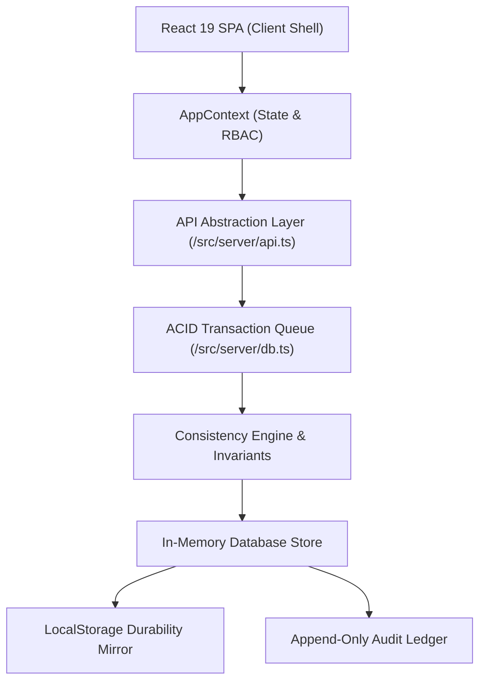
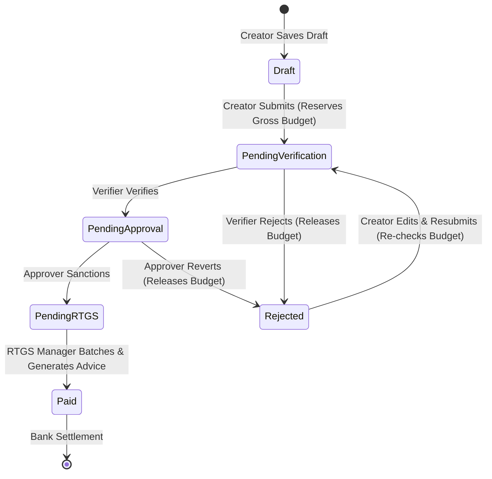
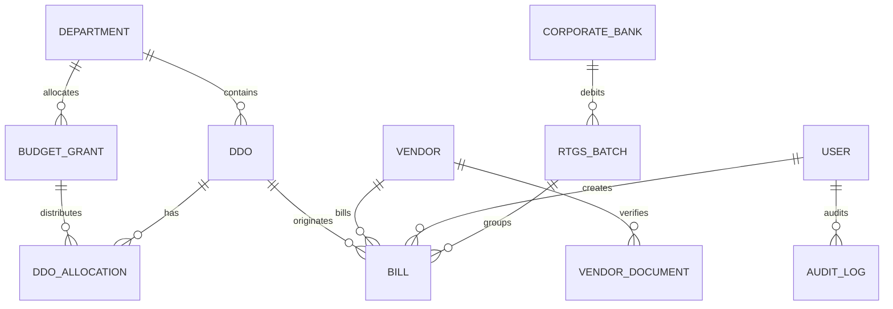

# 🏛️ GBA Corporation DC-BMS — Architecture Specification

This document details the software architecture, data modeling, concurrency model, and security controls of the **Detailed Contingent (DC) Bill Management System**.

---

## 1. High-Level Architecture

The system follows a clean, decoupled layered architecture designed for instant swapping between the in-memory transactional mock server and a production Node.js/PostgreSQL backend:



---

## 2. Bill Lifecycle State Machine

The bill status lifecycle is modeled as a deterministic finite state machine (FSM) enforcing one-way progress with budget rollback upon rejection:



---

## 3. Entity Relationship (ER) Diagram



---

## 4. ACID Concurrency & Race Condition Elimination

### Problem: Concurrent Submission Race
If two Creators belonging to the same DDO submit bills at the same second with a remaining balance of `₹1,00,000`, and both bills are for `₹70,000`:
- **Naive Systems:** Both see `remaining >= 70,000` $\rightarrow$ both submit $\rightarrow$ utilized becomes `₹1,40,000` (overspent by `₹40,000`).
- **GBA DC-BMS Solution:**
  1. All write transactions pass through a single promise serialization chain (`this.transactionQueue = this.transactionQueue.then(...)`).
  2. Transaction 1 deep-clones state, verifies `(remaining >= 70,000)`, updates utilized, verifies invariants, and commits. Remaining is now `₹30,000`.
  3. Transaction 2 begins, re-checks balance against updated remaining (`30,000 < 70,000`), detects violation, and aborts with `"Insufficient DDO Budget Balance."`. State remains consistent.

### PostgreSQL Production Equivalent
```sql
UPDATE ddo_allocations
SET utilized = utilized + :gross_value,
    updated_at = NOW()
WHERE ddo_id = :ddo_id
  AND (allocated - utilized) >= :gross_value;
-- Returns affected rows = 0 for the losing concurrent transaction.
```

---

## 5. Security & Isolation Controls

1. **Strict Operational DDO Isolation:**
   - Operational queries (`getBills`, `getBillById`, `getDdoAllocations`) enforce server-side filtering against `currentUser.ddoIds`.
   - Direct API calls with cross-DDO parameters fail with `HTTP 403 Forbidden`.

2. **Immutable Audit Ledger:**
   - Logs: `Timestamp`, `ActionType`, `UserID`, `Role`, `EntityType`, `EntityID`, `OldValue`, `NewValue`.
   - The API layer provides **zero** methods to update or delete audit records.
   - In PostgreSQL, permissions `UPDATE` and `DELETE` on table `audit_logs` are revoked from all database roles.

3. **DOM-Level Tamper Resistance:**
   - Verifier and Approver review modals render all inputs as plain text labels (`span` / `div`), completely eliminating DOM tampering or inspect-element hacks.
